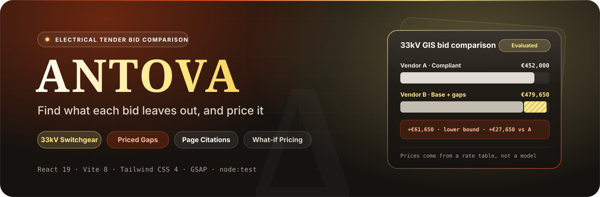
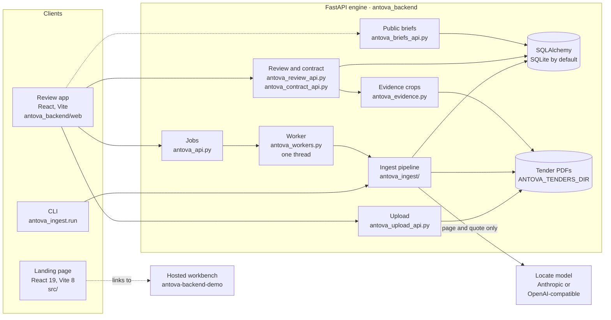
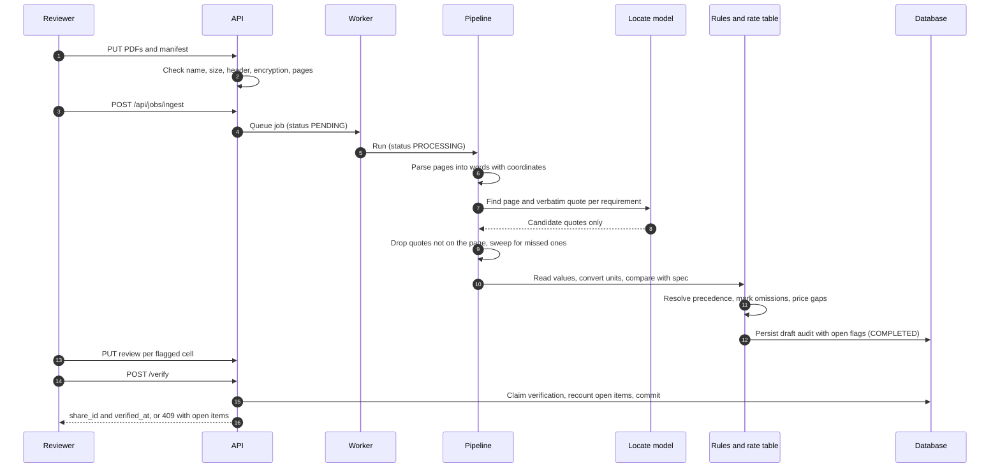
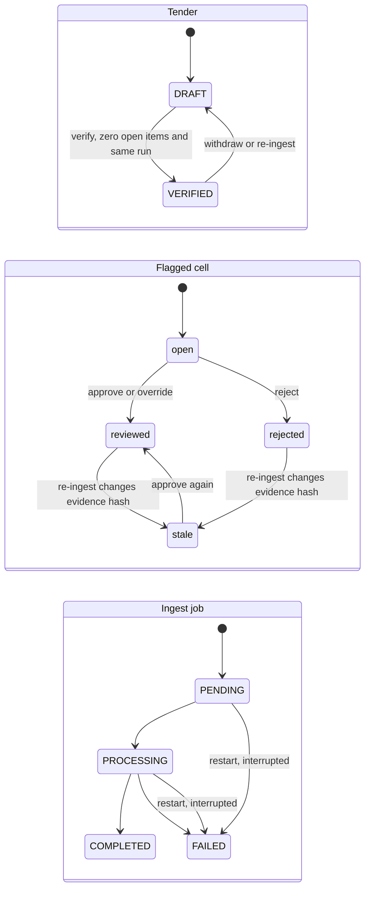
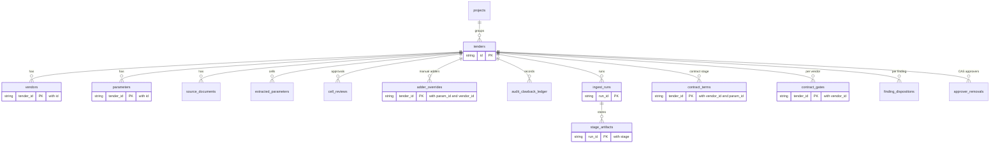
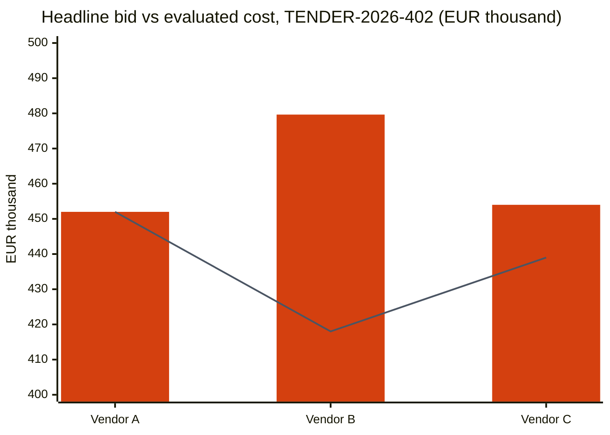

<p align="center">
  
</p>

<h1 align="center">Antova</h1>

<p align="center">
  <b>The cheapest bid isn't the cheapest.</b><br/>
  Antova reads every vendor bid against your technical specification, prices what each bid leaves out,<br/>
  and ties every flag to the page and the exact words behind it.
</p>

<p align="center">
  <a href="https://antova.vercel.app"><b>Website</b></a> ·
  <a href="https://antova-workbench.akhilfut.workers.dev"><b>Live workbench</b></a> ·
  <a href="https://github.com/akhilyad/antova-backend-demo"><b>Workbench repo</b></a> ·
  <a href="antova_backend/docs/yc-demo-roadmap.md"><b>Roadmap</b></a>
</p>

<p align="center">
  <a href="https://github.com/akhilyad/antova-yc/actions/workflows/ci.yml"></a>
  
  
  
  
  
</p>

**Contents:** [Problem](#1-problem-and-scope) · [Requirements](#2-requirements) · [Architecture](#3-system-architecture) · [Pipeline](#4-pipeline-execution) · [Lifecycles](#5-state-lifecycles) · [Data model](#6-data-model) · [API](#7-api-contract) · [Results](#8-results-and-metrics) · [Failure modes](#9-failure-modes-and-trade-offs) · [Layout](#10-repository-layout) · [Setup](#11-local-setup-and-configuration) · [Deployment](#12-deployment-topology) · [Status](#13-status-and-known-limits) · [Related repo](#14-related-repository)

---

## 1. Problem and scope

An industrial equipment tender runs to hundreds of pages per bid. The lowest quote often wins because the missing items sit in one footnote: a lower short-circuit rating, aluminium busbars where copper was specified, factory testing "charged extra", freight left out. After award they come back as change orders.

Today a buyer's engineer finds these by hand, in a spreadsheet, under deadline. Antova automates the repetitive part and keeps the judgment with a person:

- **Reads** each bid for the sentence that answers each requirement, with its page and position.
- **Checks** the values in code. Units are converted (104 °F becomes 40 °C) before they meet the spec limit.
- **Prices** each gap from a versioned rate table. An unknown quantity is marked unpriced, never counted as zero.
- **Halts for approval.** A named reviewer on the buyer's procurement team approves every flag before an audit is final. The award decision stays with the buyer.

**Supported today:** 33 kV gas-insulated switchgear (equipment class `mv_gis_switchgear`, plus an extended class `mv_gis_switchgear_ext` that adds contract-stage findings).
**Out of scope:** OCR of scanned pages, rate ranges, currency conversion, award recommendation.

**Design rule.** The model only finds quotes. It returns a page number and the verbatim words, nothing else. Every number, unit, pass/fail decision and euro amount is produced by code, and a quote that is not on its page word for word is dropped.

## 2. Requirements

### Functional

| ID | Requirement | Implemented in |
| :-- | :-- | :-- |
| FR-1 | Accept a spec, vendor bid PDFs and a manifest. Reject anything that is not a readable, unencrypted PDF before it is stored. | `antova_upload_api.py` |
| FR-2 | Locate, per requirement, the page and verbatim quote that answers it. | `antova_ingest/extract.py` |
| FR-3 | Drop any quote that is not on its cited page word for word. | `antova_ingest/verify.py` |
| FR-4 | Sweep for value-shaped sentences the model missed. | `antova_ingest/sweep.py` |
| FR-5 | Parse numbers, units and clauses and compare them with the spec limit, with unit conversion. | `antova_ingest/values.py` (Pint) |
| FR-6 | Resolve conflicting evidence by document type. Keep both pages when documents contradict. Mark a missing item omitted. | `antova_ingest/precedence.py`, `ontology.py` |
| FR-7 | Price each gap from a versioned rate table. Leave unknowns unpriced and report the total as a lower bound. | `antova_ingest/costs.py`, `rates/mv_gis_switchgear_v2.json` |
| FR-8 | Review each flagged cell as approve, override or reject. Record the reviewer from the token, not from the request body. | `antova_review.py`, `antova_review_api.py`, `antova_auth.py` |
| FR-9 | Make a review stale when a re-ingest changes the cell it approved. | `antova_review.py` (`evidence_hash`) |
| FR-10 | Refuse to verify a brief while any item is open or if the run changed since the reviewer read it. | `antova_review_api.py` (`verify`) |
| FR-11 | Export the verified workbook and a vendor clarification log. Refuse the workbook while the brief is a draft. | `antova_review_api.py`, `antova_export.py` |
| FR-12 | Serve a verified brief read-only through an unguessable share ID. | `antova_briefs_api.py` |
| FR-13 | Contract stage: check offered terms against a framework agreement and the owner contract, record a disposition per finding, and assemble a contract approval sheet (CAS) per vendor. | `antova_contract_api.py`, `antova_cas.py`, `antova_ingest/contract_*.py` |

### Non-functional

| Area | Requirement | Where it holds |
| :-- | :-- | :-- |
| Determinism | No verdict, number or price comes from a model. | Design rule above; model output limited to page and quote |
| Traceability | Every flag carries document, page and quote. Evidence crops are cut from the source PDF. | `antova_evidence.py` |
| Upload limits | 50 MB per PDF, 600 pages per PDF, 40 PDFs per tender, manifest up to 256 KB. Env-overridable. | `ANTOVA_MAX_UPLOAD_MB`, `ANTOVA_MAX_PDF_PAGES`, `ANTOVA_MAX_TENDER_FILES` |
| Concurrency | One ingest worker. Documents are located 3 at a time by default (1 to 8). | `antova_workers.py`, `ANTOVA_LOCATE_CONCURRENCY` |
| Durability | Job status is stored in the database. The queue is in memory, so a job running at restart is marked `FAILED` ("interrupted") and is never re-run automatically. | `antova_workers.py` |
| Auth | No default token. `ANTOVA_REVIEW_TOKEN` (one shared reviewer) or `ANTOVA_REVIEWERS` (named reviewers with roles). | `antova_auth.py` |
| Probe safety | Public briefs answer every miss with the same 404 body. | `antova_briefs_api.py` |
| Test safety | CI never calls a paid API: `conftest.py` blanks credentials and uses a temporary database. | `.github/workflows/ci.yml` |

## 3. System architecture



The landing page has no live tool. The deployed workbench that visitors can use lives in [antova-backend-demo](https://github.com/akhilyad/antova-backend-demo).

## 4. Pipeline execution



Progress reported by the pipeline (`antova_ingest/pipeline.py`):

| Stage | Progress | What happens |
| :-- | --: | :-- |
| Intake | 5 | Manifest and documents are read. |
| Parse | 20 | PDF pages become words with bounding boxes. A page with no text layer is flagged, not guessed. |
| Locate | 60 | The model proposes a page and quote per requirement. |
| Check each quote is on its page | 70 | `verify.py` drops quotes that are not there word for word. |
| Read values | 80 | `values.py` extracts and normalises numbers and units. |
| Check where documents disagree | 85 | `precedence.py` ranks evidence and keeps both pages on a conflict. |
| Price | 90 | `costs.py` prices gaps from the rate table. Persist completes the job at 100. |

**Evidence precedence** (lower tier outranks higher, `ontology.py`):

| Tier | Document types |
| --: | :-- |
| 0 | MR spec |
| 1 | drawing, BOM, datasheet, test plan, commercial terms |
| 2 | compliance table |
| 3 | cover letter, general section, unlabeled |

**The eight evaluated parameters** (class `mv_gis_switchgear`):

| ID | Parameter | Criticality |
| :-- | :-- | :-- |
| PARAM-01 | Rated short-time withstand current (Ik) and duration | Mandatory |
| PARAM-02 | Main busbar material and continuous current | Mandatory |
| PARAM-03 | Enclosure ingress and internal arc rating | High |
| PARAM-04 | IED protection and redundant IEC 61850 PRP | High |
| PARAM-05 | Witnessed factory acceptance test (I-FAT) | Commercial |
| PARAM-06 | Incoterms 2020, site unloading, warranty months | Commercial |
| PARAM-07 | Rated voltage (Ur) | Mandatory |
| PARAM-08 | Max ambient temperature without derating | Mandatory |

## 5. State lifecycles

**Tender, cell review and ingest job.** A re-ingest sends a verified tender back to `DRAFT`. An approval survives a re-ingest only if the cell's evidence hash is unchanged.



A cell with no flags has no review state (`none`). The contract stage keeps its own gate per vendor (`contract_gates`, `DRAFT` or `VERIFIED`) and never changes the tender's status or its open items. Dispositions on a finding are `accept`, `negotiate` or `waiver_needed`, are only ever appended, and are frozen while that vendor's gate is `VERIFIED`.

## 6. Data model

Keys shown are the primary keys in `antova_db.py`. Child tables reference `tenders`.



Standalone tables: `ingest_jobs` (`job_id`), `counterparties`, `price_history`, `deletion_log`, `schema_version`. The database defaults to SQLite (`ANTOVA_DATABASE_URL`).

## 7. API contract

33 operations, generated from the app's OpenAPI document. Everything under `/api/review` and `/api/jobs` needs the `X-Antova-Review-Token` header. `/api/briefs` and `/api/health` do not.

| Group | Method and path | Purpose |
| :-- | :-- | :-- |
| System | `GET /api/health` | Liveness |
| Upload | `PUT /api/review/tenders/{id}/files/{filename}` · `GET …/files` · `PUT …/manifest` | Intake with checks |
| Jobs | `POST /api/jobs/ingest` · `GET /api/jobs/{job_id}` | Queue and poll an ingest |
| Review | `GET /api/review/tenders` · `GET …/{id}` | List tenders, load a brief |
| Review | `POST …/{id}/evaluate` | Recompute prices with sensitivity settings |
| Review | `GET …/{id}/evidence/{param}/{source}/{which}.png` | Quote crop from the source PDF |
| Review | `PUT/DELETE …/{id}/overrides/{param}/{vendor}` | Manual adder with a note |
| Review | `GET …/{id}/reviews` · `PUT …/{id}/reviews/{param}/{vendor}` | Per-cell approval |
| Review | `POST …/{id}/verify` · `POST …/{id}/withdraw` | Sign off, reopen |
| Exports | `GET …/{id}/export-tbe.xlsx` · `clarifications.csv` · `clarifications.xlsx` | Workbook (409 while draft), vendor questions |
| Contract | `GET …/vendors/{v}/contract` · `POST …/contract/verify` · `POST …/contract/withdraw` | Contract gate |
| Contract | `GET …/vendors/{v}/dispositions` · `PUT …/findings/{f}/disposition` | Finding dispositions |
| Contract | `GET …/vendors/{v}/cas` · `cas.docx` · `cas.pdf` · `PUT …/cas/approvers/{role}` | Contract approval sheet |
| Reference data | `DELETE /api/review/counterparties/{id}` · `POST /api/review/price-history` | Counterparty and price-history records |
| Briefs | `GET /api/briefs/{share_id}` · `POST …/evaluate` · `GET …/evidence/…png` | Public read-only brief |

Error contract: `409` with `open_items` when verify is blocked, `409` when the run changed since the reviewer read it, `409` on the workbook while the brief is a draft, and one uniform `404` on `/api/briefs`. The review-app contract is in [`antova_backend/docs/ui/api-contract.md`](antova_backend/docs/ui/api-contract.md).

## 8. Results and metrics

Benchmark: synthetic 33 kV switchgear tender `TENDER-2026-402`, three fictional vendors, known answer key (`antova_backend/samples/TENDER-2026-402/expected.json`).

| Vendor | Headline | Added by gaps | Evaluated | Price status |
| :-- | --: | --: | --: | :-- |
| A | €452,000 | €0 | €452,000 | Fully priced |
| C | €439,000 | €15,000 | €454,000 | Fully priced |
| B | **€418,000** | €61,650 | **€479,650** | Lower bound, `UNPRICED_ITEMS` |



Bars are evaluated cost, the line is the headline bid. The lowest headline bid ranks last once its gaps are priced, and its figure is a lower bound because one gap cannot be priced from the documents.

| Metric | Value | How to measure |
| :-- | :-- | :-- |
| Backend tests collected | 1,900 (Python 3.14) | `cd antova_backend && python -m pytest --collect-only -q` |
| Ingest wall-clock per bid pack | `[TBD: benchmark required]` | `python -m antova_ingest.run samples/TENDER-2026-402 --mode live --verify`, time it |
| Model cost per tender | `[TBD: benchmark required]` | Same run, with `EXPLABS_PRICE_INPUT_PER_MTOK` and `EXPLABS_PRICE_OUTPUT_PER_MTOK` set |
| Locate recall and false-flag rate on real tenders | `[TBD: benchmark required]` | `antova_ingest/eval.py` on 3 to 5 real or redacted bid packs (roadmap 1.3) |
| `POST …/evaluate` latency | `[TBD: benchmark required]` | Time the route against the benchmark tender |

Accuracy on the generated edge-case packs is computed by `antova_ingest/eval.py`. No result is published here because the parser has not been run on customer documents.

## 9. Failure modes and trade-offs

| Situation | Behaviour |
| :-- | :-- |
| PDF is not a PDF, is encrypted, too large, or too long | Rejected at upload, nothing replaced |
| Page has no text layer (scanned) | Flagged for manual review. OCR is not supported |
| Model quote is not on its page | Dropped. The cell is treated as not found |
| Model refuses, returns invalid output, or a document is too large | That bid degrades. The run continues |
| Documents contradict each other | Both pages kept, higher evidence tier wins |
| Item the bid never mentions | Marked omitted and priced |
| Quantity cannot be priced from the documents | Marked unpriced. Total reported as a lower bound |
| Warranty counted from a different start point | Flagged, unpriced unless the spec states the gap |
| Server restarts during a run | Job marked `FAILED` (interrupted). Paid runs are never restarted automatically |
| Re-ingest changes a reviewed cell | Review becomes stale. Overrides on unchanged cells survive |
| Verify with open items, or after a re-ingest | `409`, nothing committed |

| Decision | Chosen | Cost |
| :-- | :-- | :-- |
| Model finds quotes only | Verifiable, no hallucinated numbers | Recall depends on the locator and the sweep |
| Strict warranty rule (v2) | No invented price | Some totals are lower bounds |
| One rate per item | Simple and auditable | No rate ranges, no currency conversion |
| One in-process worker and SQLite default | Simple to run and reason about | One instance only; Postgres needed beyond one disk |
| Human approval of every flag | Audit is defensible | Throughput bounded by reviewers |

## 10. Repository layout

```text
.
├── src/                          Landing page (React 19, Vite, Tailwind 4)
│   ├── constants.ts              Page copy; figures come from the benchmark package
│   ├── data/tender402.ts         Benchmark package as the page renders it
│   └── utils/audit.test.ts       Copy and figure checks
├── public/                       Logo, banner, founder photo
├── antova_backend/               Audit engine (Python, FastAPI, SQLAlchemy)
│   ├── antova_api.py             App entry, jobs, health
│   ├── antova_upload_api.py      Intake with checks
│   ├── antova_review_api.py      Reviews, overrides, verify, exports
│   ├── antova_contract_api.py    Contract gate, dispositions, CAS
│   ├── antova_briefs_api.py      Public read-only briefs
│   ├── antova_auth.py            Reviewer tokens
│   ├── antova_workers.py         Ingest worker
│   ├── antova_engine.py          Evaluated prices, ranking, what-ifs
│   ├── antova_db.py              Schema and repository
│   ├── antova_ingest/            Pipeline (parse, extract, verify, sweep, values, precedence, costs, contract_*)
│   ├── samples/                  Reference tenders and generator
│   ├── web/                      Review app (React, Vitest, Playwright)
│   └── docs/                     Roadmap, deploy checklist, UI contract
├── plans/  specs/                Design history
└── .github/workflows/ci.yml      Landing, engine and review-app jobs
```

## 11. Local setup and configuration

Requires Python 3.12+ and Node 20+.

```bash
# Landing page
npm install && npm run dev            # http://localhost:3000
npm test

# Engine tests (never call a paid API)
cd antova_backend
pip install -r antova_requirements.txt
python -m pytest -q

# Run the pipeline offline on the benchmark and compare with the answer key
python -m antova_ingest.run samples/TENDER-2026-402 --mode replay --verify

# Serve the API (single worker: the queue is in-process)
ANTOVA_REVIEW_TOKEN=change-me uvicorn antova_api:app --port 8000

# Review app
cd web && npm ci && npm run dev
```

| Variable | Purpose |
| :-- | :-- |
| `ANTOVA_REVIEW_TOKEN` / `ANTOVA_REVIEWERS` | Reviewer auth. No default |
| `EXPLABS_API_KEY`, `EXPLABS_MODEL`, `EXPLABS_BASE_URL` | OpenAI-compatible locate model |
| `ANTHROPIC_API_KEY`, `ANTOVA_LOCATOR_MODEL` | Anthropic locate path |
| `ANTOVA_LOCATE_PROVIDER`, `ANTOVA_LOCATE_CONCURRENCY` | Provider and parallel documents (1 to 8) |
| `ANTOVA_DATABASE_URL` | Defaults to `sqlite:///./antova_enterprise.db` |
| `ANTOVA_TENDERS_DIR` | Required for upload routes |
| `ANTOVA_MAX_UPLOAD_MB`, `ANTOVA_MAX_PDF_PAGES`, `ANTOVA_MAX_TENDER_FILES` | Intake limits |
| `VITE_INTAKE_ENDPOINT`, `VITE_WORKBENCH_URL` | Landing page, public by design |

Copy `antova_backend/.env.example` to `antova_backend/.env` for live runs.

## 12. Deployment topology

| Surface | Code | Host |
| :-- | :-- | :-- |
| Website | this repo, `src/` | Vercel, https://antova.vercel.app |
| Live workbench | [antova-backend-demo](https://github.com/akhilyad/antova-backend-demo) | Cloudflare Workers with R2 |
| FastAPI engine | `antova_backend/` | Not hosted. Run locally. See [`deploy-checklist.md`](antova_backend/docs/deploy-checklist.md) for a single-container plan |

## 13. Status and known limits

- The reference tenders are synthetic: generated documents, fictional vendors, a known answer key. The parser has not been run on customer tenders.
- Scanned pages are flagged, not read.
- Rate tables carry one rate per item. Ranges and currency conversion are not built.
- Both repositories carry a copy of the engine and they have drifted. See [section 14](#14-related-repository).
- Next steps are in [`antova_backend/docs/yc-demo-roadmap.md`](antova_backend/docs/yc-demo-roadmap.md).

## 14. Related repository

| | `antova-yc` (this repo) | [`antova-backend-demo`](https://github.com/akhilyad/antova-backend-demo) |
| :-- | :-- | :-- |
| Role | Product and audit engine: ingest, rules, review, contract stage | Hosted workbench and serving layer |
| Engine operations | 33 (adds contract gate, CAS, counterparties, price history) | 23 (adds the `documents` route) |
| Engine extras | Contract-stage modules, 20 tables | Request IDs, per-route rate limits, 12 tables |
| UI | Landing page, review app | Next.js workbench with a built-in TypeScript engine |
| Hosting | Vercel (landing) | Cloudflare Workers |

**Ownership.** This repository owns the audit engine: `antova_ingest/` (the workbench copy has none of the contract-stage modules, `price_history.py` or `retention.py`), the rate tables and the review rules. The workbench repository owns how the engine is served and deployed. Engine changes land here first and are then mirrored there. The two copies of the engine files have drifted, and the serving-layer additions in the workbench copy (request IDs, rate limits, the `documents` route) have not been ported back yet.

## License

See [LICENSE](LICENSE).
